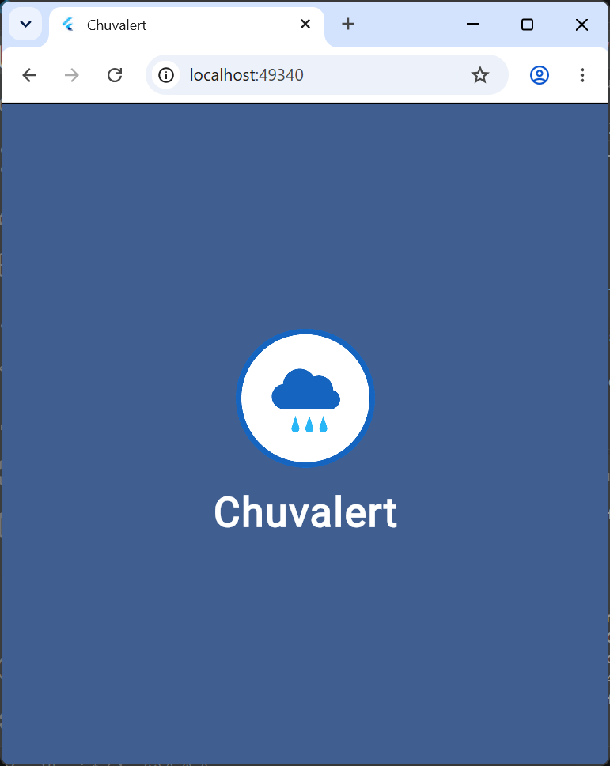
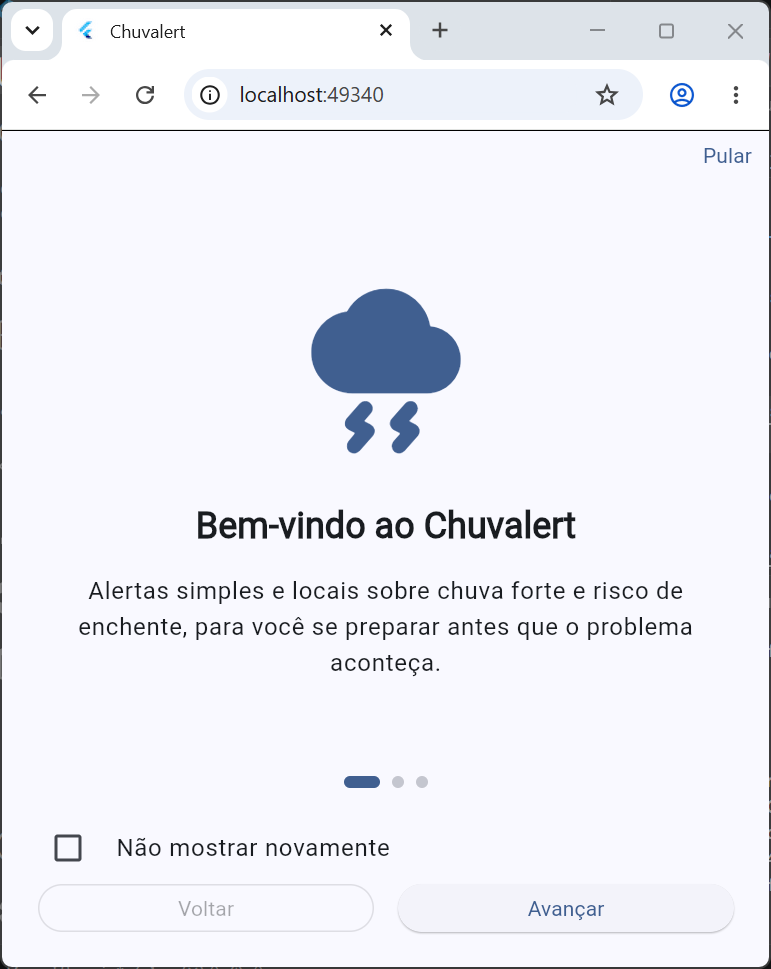
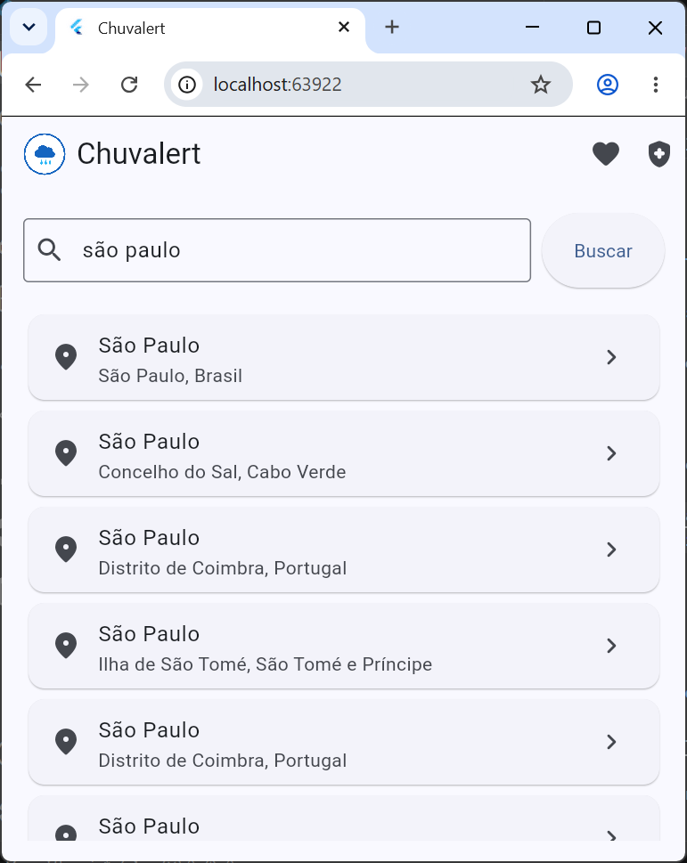
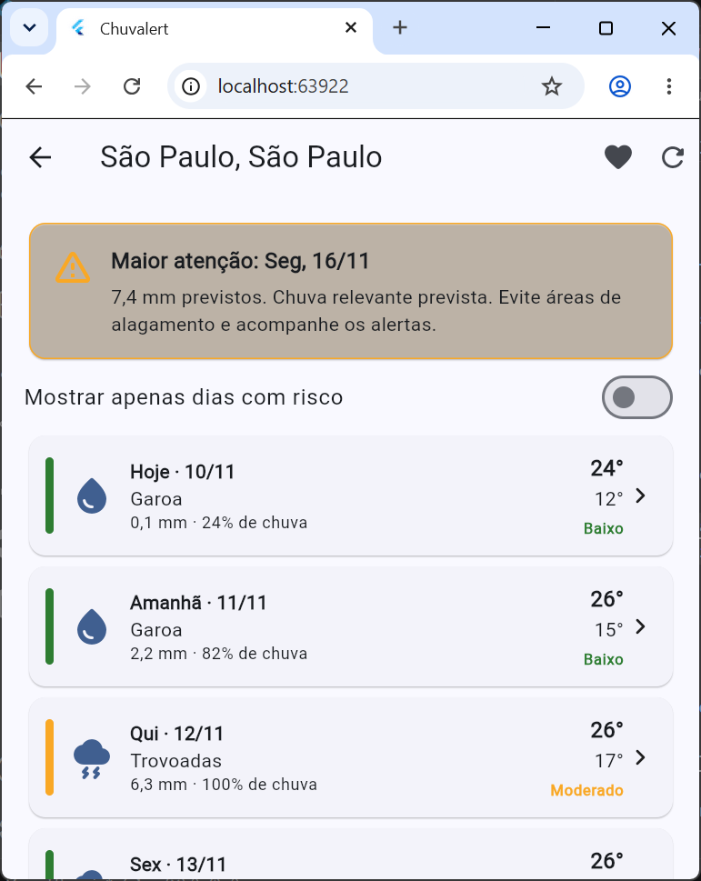
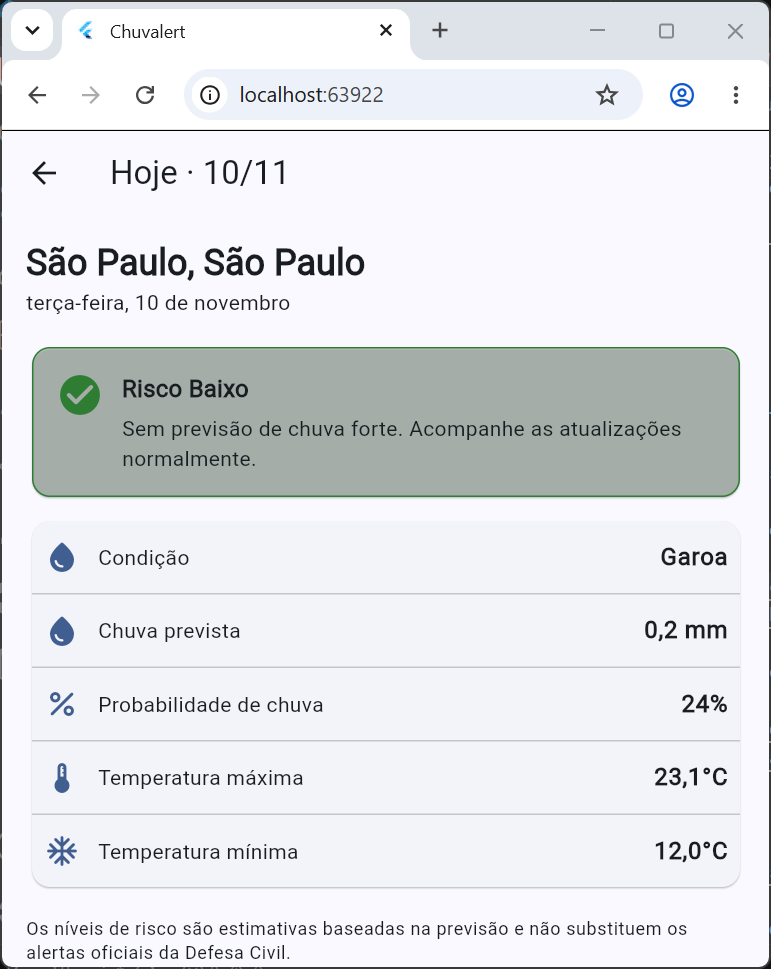
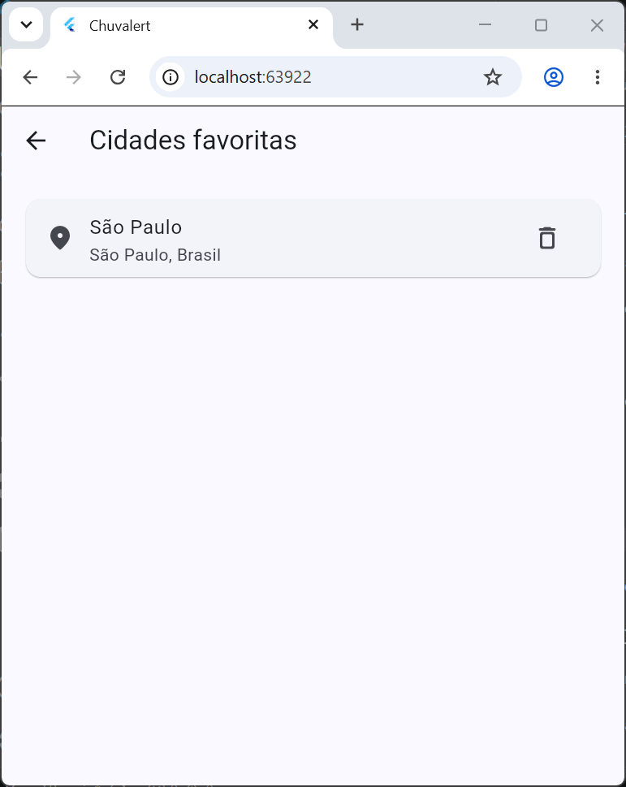
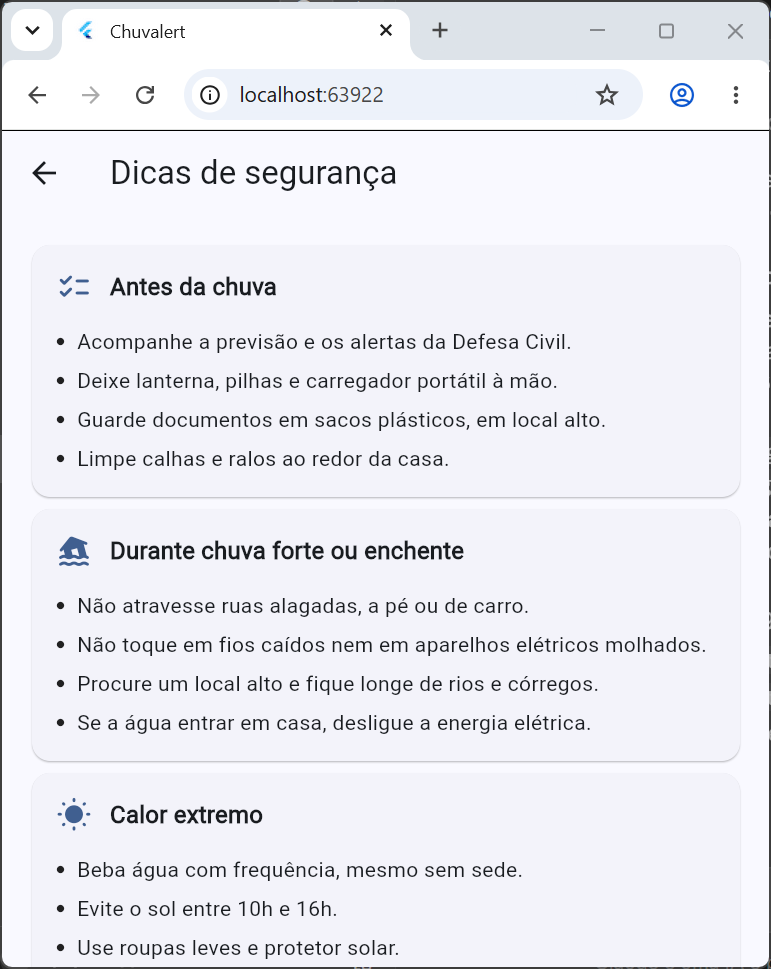
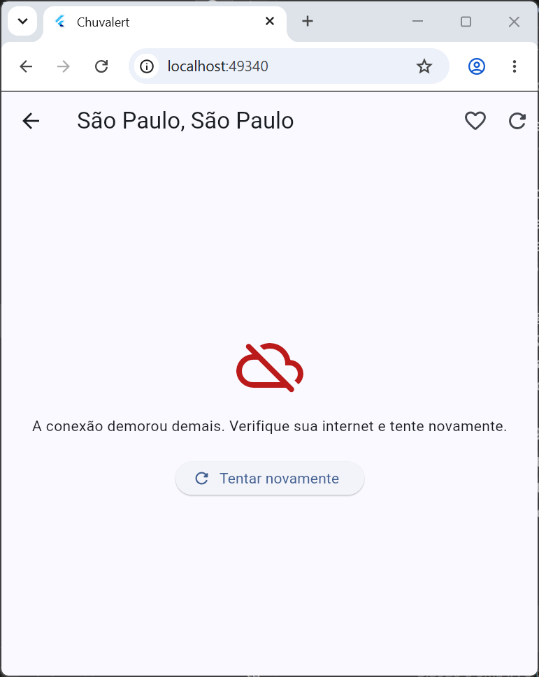

# Chuvalert

Aplicativo mobile em Flutter que informa a previsão de chuva dos próximos 7 dias para qualquer cidade e classifica cada dia em um **nível de risco de enchente** (baixo, moderado ou alto), com orientações de segurança para o cidadão.

## Desenvolvedores

| Nome completo | RM |
|---------------|----|
| Davi Queiroz Santos | 557483 |
| Eduardo Augusto Risch | 555212 |

## Tema da Global Solution

**CitizenTech**: tecnologias criadas a partir das necessidades reais das pessoas.

**Problema:** enchentes e chuvas fortes afetam a vida de milhões de brasileiros, e muitas vezes a população não recebe informação simples, localizada e fácil de entender para se preparar.

**Solução:** o Chuvalert transforma dados de previsão em um alerta claro por dia, com cores, nível de risco e orientação prática. O app é simples, não exige cadastro e guarda as cidades favoritas e a última consulta no próprio aparelho.

**ODS relacionados:**

- **ODS 11 – Cidades e comunidades sustentáveis:** reduz a exposição da população urbana a desastres relacionados à água.
- **ODS 13 – Ação contra a mudança global do clima:** apoia a adaptação a eventos climáticos extremos com informação acessível.

## Funcionalidades

- Splash com logo e verificação do onboarding.
- Onboarding com 3 páginas e opção "Não mostrar novamente".
- Busca de cidades pelo nome.
- Previsão de 7 dias com chuva (mm), probabilidade e temperaturas.
- Nível de risco por dia (verde, amarelo e vermelho) e resumo do dia de maior atenção.
- Filtro para exibir apenas dias com risco.
- Detalhes do dia com orientação de segurança.
- Cidades favoritas e última cidade consultada, salvas localmente.
- Dicas de segurança e telefones de emergência.
- Atualização por gesto de puxar e tratamento de erro com botão "Tentar novamente".

## Fluxo de telas

```
Splash ──► Onboarding (primeira vez ou sem "Não mostrar novamente")
   │            │
   └────────────┴──► Home (busca)
                       ├──► Previsão da cidade ──► Detalhes do dia
                       ├──► Favoritos ──► Previsão da cidade
                       └──► Dicas de segurança
```

## Prints das telas

Salve os prints na pasta `docs/prints/` com os nomes abaixo.

| Splash | Onboarding | Home |
|--------|------------|------|
|  |  |  |

| Previsão | Detalhes do dia | Favoritos |
|----------|-----------------|-----------|
|  |  |  |

| Dicas | Erro de conexão |
|-------|-----------------|
|  |  |

## API utilizada

[Open-Meteo](https://open-meteo.com/) é uma API REST pública e gratuita que não exige chave.

| Uso | Endpoint |
|-----|----------|
| Busca de cidades | `GET https://geocoding-api.open-meteo.com/v1/search?name={cidade}&count=10&language=pt` |
| Previsão de 7 dias | `GET https://api.open-meteo.com/v1/forecast?latitude={lat}&longitude={lon}&daily=weathercode,temperature_2m_max,temperature_2m_min,precipitation_sum,precipitation_probability_max&timezone=auto&forecast_days=7` |

As respostas JSON são convertidas em objetos Dart (`Cidade` e `Previsao`).

### Regra do nível de risco

O nível é calculado em `lib/utils/nivel_risco.dart` a partir da chuva prevista no dia e da probabilidade de precipitação:

| Nível | Critério |
|-------|----------|
| Alto | 50 mm ou mais, ou 30 mm ou mais com probabilidade de 70% ou mais |
| Moderado | 15 mm ou mais, ou 5 mm ou mais com probabilidade de 60% ou mais |
| Baixo | Demais casos |

Os limites são estimativas definidas pela equipe para este protótipo e **não substituem os alertas oficiais da Defesa Civil**.

## Arquitetura

O projeto separa interface, modelos, serviços e regras de apresentação. O gerenciamento de estado usa `setState`.

```
lib/
├── main.dart                  Ponto de entrada e tema
├── models/                    Cidade, Previsao, Dica, PaginaOnboarding
├── services/
│   ├── clima_service.dart         Acesso à API (pacote http) e tratamento de erros
│   └── preferencias_service.dart  Persistência local (SharedPreferences)
├── screens/                   Splash, Onboarding, Home, Previsão,
│                              Detalhes do dia, Favoritos, Dicas
├── widgets/                   Componentes reutilizáveis
└── utils/                     Regra de risco, análise, formatação e constantes
```

**Estados da requisição** (`EstadoCarregamento`): inicial, carregando, sucesso e erro, com mensagem amigável e botão para tentar novamente.

**Persistência local** (`SharedPreferences`): flag do onboarding, cidades favoritas e última cidade consultada.

## Tecnologias

- Flutter e Dart
- Pacote `http`
- Pacote `shared_preferences`
- Material 3

## Como executar

```
flutter pub get
flutter run
```

Para rodar os testes e a análise estática:

```
flutter test
flutter analyze
```